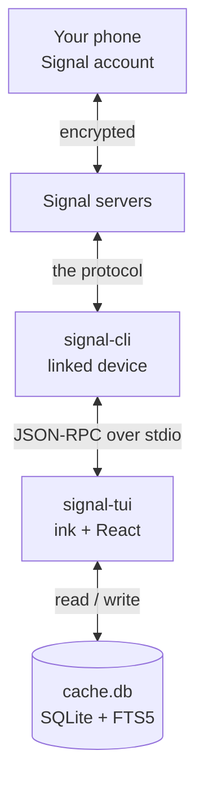
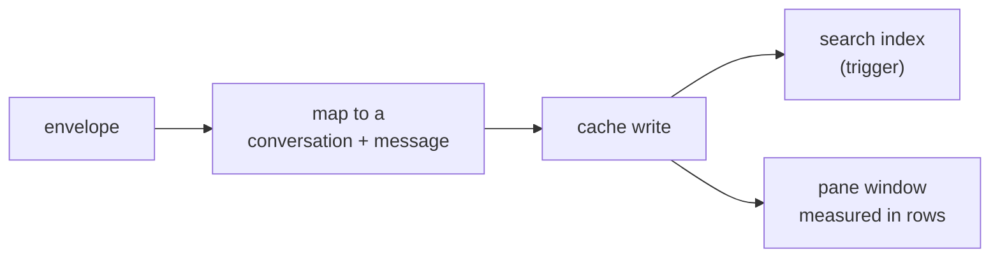

# signal-tui

A terminal Signal client. Ink + Bun, local-first: messages live in SQLite on your
machine, and the TUI never touches the network itself — it drives
[`signal-cli`](https://github.com/AsamK/signal-cli) over JSON-RPC on stdio.

**Status: `0.5.0` — usable for text conversations, and it moves files both ways.** Read, send,
groups, replies, reactions, edits, delete-for-everyone, local hiding, forwarding, typing
indicators, unread counts, read receipts, sending a file with a caption, and opening a file
someone sent work against a real account. What changed, and when, is in
[CHANGELOG.md](./CHANGELOG.md).

> **Unofficial.** Not affiliated with Signal Messenger LLC. It is a terminal front
> end for [`signal-cli`](https://github.com/AsamK/signal-cli), which does the
> protocol work.

## Contents

- [Changelog](./CHANGELOG.md)
- [Before you start](#before-you-start)
- [Install](#install)
- [Link your account](#link-your-account)
- [First run](#first-run)
- [Settings](#settings)
- [Keys](#keys)
- [How it works](#how-it-works)
- [What works](#what-works)
- [Not there yet](#not-there-yet)
- [Security notes](#security-notes)
- [Troubleshooting](#troubleshooting)
- [From source](#from-source)
- [Architecture](#architecture)
- [License](#license)

## Before you start

`signal-tui` is a **front end**. It cannot talk to Signal's servers and it cannot
link a device by itself — [`signal-cli`](https://github.com/AsamK/signal-cli) does
both. Install and verify `signal-cli` first; the TUI is useless without it.

| You need | Why | Notes |
|---|---|---|
| **A Signal account on your phone** | this computer becomes a *linked device* | Signal → Settings → Linked devices |
| **`signal-cli` 0.14+** on `PATH` | speaks the protocol | the GraalVM native build needs no Java |
| **Bun 1.4.3+** | the TUI runs on Bun, not Node | `curl -fsSL https://bun.sh/install \| bash` |
| **`qrencode`** | turns the link URI into a scannable code | both linking routes use it; no text fallback |

Step-by-step instructions for each platform, including verifying the `signal-cli`
download before you run it: **[SETUP.md](./SETUP.md)**.

```sh
signal-cli --version     # must print 0.14.x or newer
```

## Install

```sh
npm i -g signal-tui       # the bin is run by bun, so Bun must be on PATH
signal-tui --version
signal-tui --demo         # built-in sample data: no account, no signal-cli
```

`--demo` is the honest first step: it shows the interface without touching your
account or requiring `signal-cli` at all.

## Link your account

Linking is a one-time step, and it always needs your phone: Signal shows a QR code
that the phone scans. **Nothing can automate that part.**

```sh
signal-cli link -n signal-tui     # prints a sgnl://linkdevice?… URI
```

The native build's QR art is unusable (its charset is US-ASCII, so it emits `?`
instead of block characters), so render the URI yourself:

```sh
signal-cli link -n signal-tui | grep -o 'sgnl://[^ ]*' \
  | tr -d '\n' | qrencode -t ANSIUTF8       # scan the QR with your phone
```

The URI goes in on **stdin**, never as an argument: a command line is readable by
every user on the machine through `/proc/<pid>/cmdline` while `qrencode` runs, and a
device-link URI is a credential.

Then **Signal → Settings → Linked devices → Link new device**. `signal-cli`
confirms with `Associated with: +48…`.

If you have the package — cloned or installed — `bun run link` does the same thing
and writes a PNG instead, which is easier to scan from a phone. Run it from a clone,
or from the installed package directory (`~/.bun/install/global/node_modules/signal-tui`).
It needs `qrencode` for that; without it the script prints the URI and install help
and stops, exactly like the one-liner above:

```sh
bun run link
```

## First run

```sh
signal-tui --account +48123456789
```

| Flag | Meaning |
|---|---|
| `--account <number>` | the linked account to act as |
| `--db <path>` | cache location (default `$XDG_DATA_HOME/signal-tui/cache.db`, else `~/.local/share/signal-tui/cache.db`) |
| `--notify` / `--no-notify` | desktop toast and bell for a message in another thread (on by default) |
| `--ignore-attachments` | do not download the files that arrive with messages |
| `--demo` | sample data, no account |
| `--version`, `--help` | what they say |

The first sync fills the cache with what your account can see. History from before
you linked that device is not available — Signal does not backfill it.

## Settings

Standing preferences live in one JSON file — `$XDG_CONFIG_HOME/signal-tui/config.json`, else
`~/.config/signal-tui/config.json`. All of it is optional; a missing file is the defaults.

```json
{
  "notify": false,
  "ignoreAttachments": true,
  "db": "/home/you/.local/share/signal-tui/cache.db",
  "engineArgs": ["--config", "/home/you/.config/signal-cli"]
}
```

| Key | Meaning |
|---|---|
| `notify` | toast and bell for a message in a thread you are not looking at |
| `ignoreAttachments` | stop `signal-cli` downloading every file that arrives into its own directory |
| `db` | where the cache lives — the same thing `--db` sets, for every run |
| `engineArgs` | extra arguments for `signal-cli`, placed before its `jsonRpc` subcommand — they must be options of `signal-cli` itself (a `jsonRpc` option placed there is rejected) |

**`flag > env > file > default`**, per setting: `--db` beats `SIGNAL_TUI_DB`, which beats `"db"`;
`--notify`/`--no-notify` beats `SIGNAL_TUI_NOTIFY` (`on`/`off`, `1`/`0`, `true`/`false`), which
beats `"notify"`; `--ignore-attachments` beats `SIGNAL_TUI_IGNORE_ATTACHMENTS`, which beats
`"ignoreAttachments"`. Engine arguments are file-only — they are a standing preference, not
something to retype per run.

**`ignoreAttachments` costs you the file names.** `signal-cli` never downloads a file it was told
to ignore, so it cannot report a filename: the pane keeps showing the message and says
`📎 image/jpeg (1.6 MB)` instead of `📎 photo.jpg (1.6 MB)`. It is the honest trade for a client
that does not want a copy of every attachment a stranger sends sitting in
`~/.local/share/signal-cli/attachments`, where nothing deletes it.

A config file that cannot be used is an error rather than a shrug: an unknown key, a value of the
wrong type or unreadable JSON is reported with the path and the setting, and the client exits.
Nothing secret belongs in there — the account is a flag, and the cache path is not a credential.

## Keys

| Key | Action |
|---|---|
| `Tab` / `Shift-Tab` | move between conversations → messages → composer |
| `j` / `k` | move the selection, or scroll the message pane when it has focus |
| `PgUp` / `PgDn` | scroll the message pane by ten messages |
| `i` or `⏎` | focus the composer |
| `r` | reply to the selected message (message pane) |
| `x` | react to the selected message: a picker opens — `⇥`/`↑↓` to choose, type a name (`heart`, `redheart`, `tada`) to filter, `⏎` sends. Typing the emoji you already added takes it back |
| `f` | forward a message to another conversation: the picker opens — type to narrow by name, `⇥`/`↑↓` to choose, `⏎` sends. Text only, so a message with files is refused rather than sent as its caption |
| `a` | send a file to the open conversation: the path prompt opens on the directory you started in — type to narrow, `⇥`/`↑↓` to choose, `⏎` on a folder descends into it, `⏎` on a file sends it. Whatever is in the composer rides along as the message, and a reply in progress is answered. `~` is your home; dotfiles stay hidden unless you type the dot |
| `e` | edit your own message: the prompt opens with its body, `⏎` saves, `Esc` cancels |
| `d` | delete your own message for everyone — it asks first, `⏎` or `y` confirms |
| `D` | hide a message on this device only; nothing is sent and nobody else is affected |
| `o` | open a file on the selected message with your desktop's viewer (`xdg-open`, `open` on macOS). A message with several files opens a picker — `⇥`/`↑↓` to choose, `⏎` opens the highlighted one; a message with one opens it directly, after the first press of the run. Only files `signal-cli` itself downloaded are launched; anything outside its attachments directory is refused by name |
| `⏎` | send the draft, or send the emoji while reacting |
| `/` | search cached history — `↑` / `↓` to pick a hit, `⏎` to open it, `Esc` to close |
| `Esc` | leave the composer, cancel a reply, cancel a reaction, close search |
| `q` | quit, from any pane; `Ctrl-C` quits from anywhere, modes included |

`e` and `d` act on a message you wrote, so the status line only offers them while the pointer is
on one of yours — and pressing either on someone else's message says why instead of doing
nothing. `r`, `x`, `f` and `D` work on anyone's message; `f` is offered while the message has
text, because a copy that dropped the files would be half a message. `a` is about the
conversation rather than the pointer, so it works from the list too.

The pane border shows which box has the keyboard; while a prompt is open it replaces the
composer, and its border turns red for the one that changes things for other people.

## How it works



An arriving message travels one direction, and never leaves your machine:



What that buys you: the network and the crypto belong to `signal-cli`; this project
owns the cache, the search index and the screen. Killing the TUI loses nothing but
the last second of typing.

## What works

- conversations from your account, keyed per group rather than per sender
- sending, with the message appearing immediately (Signal never echoes a transcript
  back to the device that wrote it)
- messages you send elsewhere show up here, with the server timestamp as identity
- **edits**: a correction from the other side replaces the body and marks the
  message `· edited` — including one you made on your phone, which arrives on a
  second path (`syncMessage.sentMessage`) and is applied the same way
- unread counts that clear when you open a conversation, and while you watch it
- **read receipts**: the other side sees "read" when you open the chat, not when the
  message arrives
- **delivery ticks**: your own messages show `✓` once the other side's device has one
  and `✓✓` once they read it. The strongest receipt wins, so a delivery that arrives
  after a read (a device that was offline) cannot take the second tick away.
- delete-for-everyone, reflected in the cache
- **disappearing messages**: a message whose timer runs out keeps its row so the
  thread keeps its shape, but its text and file references are deleted from the
  cache — and from the search index with them. The sweep runs at startup and after
  every incoming envelope, so a timer is honoured while you are not looking at the
  conversation. Your own sent messages inherit the conversation's timer, because
  Signal never echoes them back to the device that wrote them.
- local full-text search over cached bodies (`/`)
- **history in pages**: the newest 50 messages load first, and `k` at the top of what is
  loaded asks for the page behind it (keyset, so messages arriving mid-scroll cannot shift a
  page into a duplicate or a hole). Pages already walked back to survive an incoming message
  instead of being thrown away.
- files shown by name and size, with the caption when the sender wrote one
- **reactions**: an emoji a peer adds is shown on the message's author row (`👍 2`), a
  second emoji from the same person replaces the first, and a removal takes it away. `x` in
  the message pane adds your own, and it appears immediately without waiting for a transcript
  Signal never sends back. The prompt is a **picker**, because a terminal cannot insert an
  emoji: five suggestions are on screen the moment it opens, `⇥`/`↑↓` walk them, typing a name
  narrows the list (`heart`, `redheart`, `:tada:`, `laugh`), and the emoji you already added is
  one keystroke away from being taken back
- **editing your own message** (`e`): the prompt starts from the body, `⏎` saves, and the row
  reads `· edited` at once — the local echo goes through the same rule the other side's
  correction does, because Signal never echoes a send back to the device that wrote it
- **deleting for everyone** (`d`, then `⏎` or `y`): the message is blanked here at once and
  removed on every other device. It asks first, and only offers itself on your own message
- **hiding locally** (`D`): the row stays in the cache but no read returns it — not the thread,
  not an older page, not search — so a replayed envelope cannot bring it back as new. Nothing
  goes on the wire, which is why there is nothing to confirm
- **replies**: a message that answers another one shows what it answers, above its own
  text (`┃ 12:34 Marta: the original`). The quoted message is looked up in the thread, so a
  quote of something deleted or expired reads `message deleted` / `message expired` rather
  than reviving text that is gone — the cache keeps only *which* message is quoted, never a
  second copy of its words.
- **composing a reply**: `Tab` to the message pane, `j`/`k` to pick the message (it carries
  a `▸`), `r`, type, `⏎`. The quoted text travels with the message; the cache still keeps
  only its identity. The selection is the bottom-most message in the window, so reaching an
  older one scrolls the thread down to it.
- **sending a file** (`a`): the path prompt opens on the directory you started in, typing
  narrows it, `⏎` descends into a folder or sends a file — one file per message, up to Signal's
  100 MB. The words already in the composer are the message the file belongs to, and a reply in
  progress is answered, quote and all: "here's the CV" then `a` is one message, not two. The
  echo keeps the path, so the row shows the name and size without waiting for a transcript that
  never arrives
- **notifications**: a message in a thread you are not reading rings the terminal bell and
  sends a desktop notification (`OSC 9` — kitty, Ghostty, WezTerm, iTerm2 and Windows
  Terminal show it; a terminal without it just rings), and the window title carries the
  unread count. The text is sanitised and length-capped before it enters the sequence: a
  notification is the one place a peer's words leave the pane.
- **typing indicators**: a peer composing in the thread you have open fills the composer's
  empty row with `Marta is typing…`, and the line goes away on its own even if they stop
  without saying so. Nothing of it is stored — a notice about the present, in memory, with a
  deadline — so opening the client tomorrow never shows someone mid-sentence from last night
- **view-once messages** are recorded but never kept: their text and file references
  are not written to the cache or the search index, so the row says
  `view-once message · not stored` and there is nothing to recover later
- keyboard-first panes: the message window is measured in terminal rows, so a short
  terminal still shows the newest message rather than clipping it
- history persisted across restarts

## Not there yet

- **hiding a message for good**: `D` is a one-way write in this cache — there is no way back
  short of deleting the database, and hidden rows are not listed anywhere
- **stickers, polls, polls' votes, pins, payments and group-call updates are ignored.**
  They arrive as data messages with no text and no files, so the client does not draw a
  row for them at all — no blank line, no unread count, no notification
- quoting **attachments** in a reply, and replying to a view-once message — a reply whose
  target is outside the loaded window reads `not loaded`, because the quoted text is not
  stored
- **forwarding a message with files**: a forward sends the words only — Signal has no `forward`
  command and no "forwarded" field, so it is a re-send to another conversation, and the picker
  refuses a message with attachments rather than sending its caption alone
- the **full** emoji set: the picker carries a curated table of ~50 names rather than Unicode's
  3600, so a rare emoji has to be pasted rather than named. Adding one is a line in
  `src/domain/emoji-catalog.ts`
- an **editor** for long messages: the config file has no `editor` key yet, because nothing
  would read it — a message long enough to leave the composer for `$EDITOR` is a feature of its
  own, and a key the binary ignores is a promise it does not keep
- history from before you linked this device
- **view-once messages are not shown at all**, only announced: this client keeps no copy,
  and files are not rendered yet, so there is nothing to open. Note that `signal-cli`
  still downloads the attachment to its own directory — the guarantee is about *this*
  cache, not about the engine's storage
- `doctor` and `link` are scripts, not subcommands: run them with Bun from a clone or
  from the installed package directory, since `signal-tui` exposes only the TUI

Attachments themselves are never downloaded by this app: `signal-cli` stores them
under `~/.local/share/signal-cli/attachments`, and the pane shows the file's name and
size. `o` hands one of those paths to your desktop's viewer — and only one of *those*:
a path that is not inside the engine's directory is refused, because a filename a
sender chose must never be able to make this client run something.

## Security notes

- Linking makes this computer a **device on your account**: `signal-cli` stores the
  account keys under `~/.local/share/signal-cli`, and this TUI stores decrypted
  messages in `$XDG_DATA_HOME/signal-tui/cache.db` (`~/.local/share` when that is
  unset). Both are plaintext on disk, so
  full-disk encryption is what protects them at rest.
- The cache is created `0600` inside a `0700` directory, and `--db` refuses a
  location other users can write to.
- Message text is drawn into your terminal, so it is stripped of escape sequences
  (including the 8-bit C1 forms), bidi overrides and zero-width characters at the
  display boundary: a message cannot recolour the pane, hide its own text, or
  reorder what it says.
- This project makes **no network calls**. It talks to `signal-cli` over stdio, and
  Signal's servers see exactly what they would see for any linked device.
- Remove the device any time under **Signal → Settings → Linked devices**.

## Troubleshooting

| Symptom | Cause | Fix |
|---|---|---|
| `signal-cli not found` | not on `PATH` | install it, or add its directory to `PATH` (`SETUP.md`) |
| one actionable line, exit 1 | no account linked, or `--account` wrong | `signal-cli listAccounts` |
| QR shows `?` blocks | native build's US-ASCII charset | render the `sgnl://` URI with `qrencode` |
| `ExceptionInInitializerError`, `No space left on device` | signal-cli unpacks libsignal into `/tmp` | `JAVA_TOOL_OPTIONS="-Djava.io.tmpdir=/roomy/dir" signal-cli listAccounts` (JVM build; swap in the command you run) |
| messages arrive but the pane is empty | cache opened elsewhere | check `--db`; the cache is per path |
| several `signal-tui` windows | one `signal-cli` per account | run one TUI at a time |

`bun run doctor -- --account +48123456789` checks the engine, the account, the cache
and its permissions. It runs from a clone *or* from the installed package directory
(`~/.bun/install/global/node_modules/signal-tui` for a Bun global install), because
the tarball ships `src/` and `package.json`. What it does **not** offer is a
`signal-tui doctor` subcommand — only `signal-tui` itself is a global binary.

The engine row compares against two different versions, because one of them is not
enough. Below `0.14.0` is a **failure**: the commands this client drives did not exist.
Below `0.14.9` — the release this build was actually written and read against — is a
**warning**, since signal-cli tracks a protocol that moves and releases a few months old
stop working; it may answer today and fail next week. Above it is fine but untested, and
the row says which of those you are looking at rather than a bare tick.

## From source

```sh
git clone https://github.com/dandrok/signal-tui && cd signal-tui
bun install
bun run setup          # enables the tracked git hooks
bun run link           # link this machine (QR as a PNG)
bun start --demo       # demo mode; with no flag it prints usage and exits
bun test               # unit, adapter and ink render tests
bun run verify         # typecheck + lint + tests: the gate CI runs
```

## Architecture

Ports and adapters: `src/domain` holds no IO, and `src/ui` renders and handles keys
with ink — but neither reaches for an adapter.

```
src/
  domain/        pure types, rows, formatting helpers
  ports/         MessageStore, SignalBackend interfaces
  adapters/
    memory/      demo store       store · read · conversations · message-rules · seed
    sqlite/      durable cache    store · read-messages · conversations · message-rules
                                  + hydrate (rows → messages) · schema (runs the migrations)
    signal/      JSON-RPC engine  map-envelope/ · schemas/ · json-rpc-client/ · commands
  app/           state/ (one reducer per subject) · session/ · usecases/ (one folder per feature)
  ui/            ink components · message-pane/ · hooks/
  cli.tsx        composition root · link.ts / doctor.ts entry points
```

Both stores answer the same three questions in the same three files — which rows to read, what
a conversation is, what a message becomes — while SQLite additionally hydrates rows and owns
the schema. `tests/store-parity.test.ts` runs one script through both and compares state *and*
return values after every step, which is what keeps the two answering alike.

Four rules, all of them tests rather than intentions:

- **layering** — `noRestrictedImports` in `biome.json`: `domain` cannot reach for ink or an
  adapter, `ui` cannot reach for an adapter, `app` cannot reach for either.
- **no file over 200 lines** — `tests/architecture.test.ts` fails on any file that is longer,
  and biome reports the same limit as an error while you type. There are no exceptions.
- **no import cycles**, and no allowlist for one: the test asserts the set is empty.
- **a folder is entered through its `index.ts`** — internals stay private, and one use-case
  folder cannot import its sibling.

Schema changes are append-only migrations: `sqlite/migrations.ts` is the history, and
`sqlite/schema.ts` is the only code that runs it.

## License

MIT — see [LICENSE](./LICENSE).
