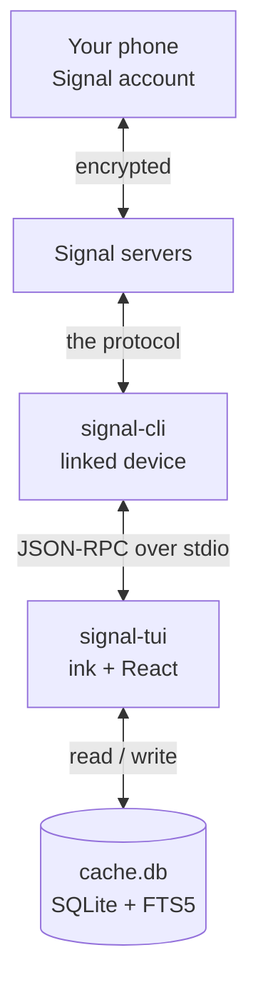
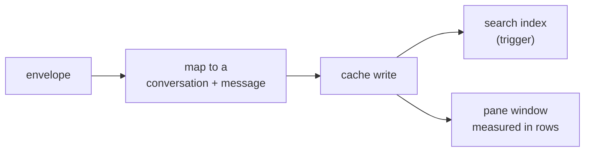

# signal-tui

A terminal Signal client. Ink + Bun, local-first: messages live in SQLite on your
machine, and the TUI never touches the network itself — it drives
[`signal-cli`](https://github.com/AsamK/signal-cli) over JSON-RPC on stdio.

**Status: `0.0.x` — usable for text conversations.** Read, send, groups, edits,
deletes, unread counts and read receipts work against a real account.

> **Unofficial.** Not affiliated with Signal Messenger LLC. It is a terminal front
> end for [`signal-cli`](https://github.com/AsamK/signal-cli), which does the
> protocol work.

## Contents

- [Before you start](#before-you-start)
- [Install](#install)
- [Link your account](#link-your-account)
- [First run](#first-run)
- [Keys](#keys)
- [How it works](#how-it-works)
- [What works](#what-works)
- [Not there yet](#not-there-yet)
- [Security notes](#security-notes)
- [Troubleshooting](#troubleshooting)
- [From source](#from-source)
- [Architecture](#architecture)
- [License](#license)

## Before you start

`signal-tui` is a **front end**. It cannot talk to Signal's servers and it cannot
link a device by itself — [`signal-cli`](https://github.com/AsamK/signal-cli) does
both. Install and verify `signal-cli` first; the TUI is useless without it.

| You need | Why | Notes |
|---|---|---|
| **A Signal account on your phone** | this computer becomes a *linked device* | Signal → Settings → Linked devices |
| **`signal-cli` 0.14+** on `PATH` | speaks the protocol | the GraalVM native build needs no Java |
| **Bun 1.4.3+** | the TUI runs on Bun, not Node | `curl -fsSL https://bun.sh/install \| bash` |
| **`qrencode`** | turns the link URI into a scannable code | both linking routes use it; no text fallback |

Step-by-step instructions for each platform, including verifying the `signal-cli`
download before you run it: **[SETUP.md](./SETUP.md)**.

```sh
signal-cli --version     # must print 0.14.x or newer
```

## Install

```sh
npm i -g signal-tui       # the bin is run by bun, so Bun must be on PATH
signal-tui --version
signal-tui --demo         # built-in sample data: no account, no signal-cli
```

`--demo` is the honest first step: it shows the interface without touching your
account or requiring `signal-cli` at all.

## Link your account

Linking is a one-time step, and it always needs your phone: Signal shows a QR code
that the phone scans. **Nothing can automate that part.**

```sh
signal-cli link -n signal-tui     # prints a sgnl://linkdevice?… URI
```

The native build's QR art is unusable (its charset is US-ASCII, so it emits `?`
instead of block characters), so render the URI yourself:

```sh
signal-cli link -n signal-tui | grep -o 'sgnl://[^ ]*' \
  | tr -d '\n' | qrencode -t ANSIUTF8       # scan the QR with your phone
```

The URI goes in on **stdin**, never as an argument: a command line is readable by
every user on the machine through `/proc/<pid>/cmdline` while `qrencode` runs, and a
device-link URI is a credential.

Then **Signal → Settings → Linked devices → Link new device**. `signal-cli`
confirms with `Associated with: +48…`.

If you have the package — cloned or installed — `bun run link` does the same thing
and writes a PNG instead, which is easier to scan from a phone. Run it from a clone,
or from the installed package directory (`~/.bun/install/global/node_modules/signal-tui`).
It needs `qrencode` for that; without it the script prints the URI and install help
and stops, exactly like the one-liner above:

```sh
bun run link
```

## First run

```sh
signal-tui --account +48123456789
```

| Flag | Meaning |
|---|---|
| `--account <number>` | the linked account to act as |
| `--db <path>` | cache location (default `$XDG_DATA_HOME/signal-tui/cache.db`, else `~/.local/share/signal-tui/cache.db`) |
| `--demo` | sample data, no account |
| `--version`, `--help` | what they say |

The first sync fills the cache with what your account can see. History from before
you linked that device is not available — Signal does not backfill it.

## Keys

| Key | Action |
|---|---|
| `Tab` / `Shift-Tab` | move between conversations → messages → composer |
| `j` / `k` | move the selection, or scroll the message pane when it has focus |
| `PgUp` / `PgDn` | scroll by ten messages |
| `i` or `⏎` | focus the composer |
| `⏎` | send (while composing) |
| `/` | search your cached history |
| `Esc` | leave the composer, close search |
| `q` | quit |

The pane border shows which box has the keyboard.

## How it works



An arriving message travels one direction, and never leaves your machine:



What that buys you: the network and the crypto belong to `signal-cli`; this project
owns the cache, the search index and the screen. Killing the TUI loses nothing but
the last second of typing.

## What works

- conversations from your account, keyed per group rather than per sender
- sending, with the message appearing immediately (Signal never echoes a transcript
  back to the device that wrote it)
- messages you send elsewhere show up here, with the server timestamp as identity
- **edits**: a correction from the other side replaces the body and marks the
  message `· edited`
- unread counts that clear when you open a conversation, and while you watch it
- **read receipts**: the other side sees "read" when you open the chat, not when the
  message arrives
- **delivery ticks**: your own messages show `✓` once the other side's device has one
  and `✓✓` once they read it. The strongest receipt wins, so a delivery that arrives
  after a read (a device that was offline) cannot take the second tick away.
- delete-for-everyone, reflected in the cache
- **disappearing messages**: a message whose timer runs out keeps its row so the
  thread keeps its shape, but its text and file references are deleted from the
  cache — and from the search index with them. The sweep runs at startup and after
  every incoming envelope, so a timer is honoured while you are not looking at the
  conversation. Your own sent messages inherit the conversation's timer, because
  Signal never echoes them back to the device that wrote them.
- local full-text search over cached bodies (`/`)
- files shown by name and size, with the caption when the sender wrote one
- keyboard-first panes: the message window is measured in terminal rows, so a short
  terminal still shows the newest message rather than clipping it
- history persisted across restarts

## Not there yet

- **Your own edits made on another device** are not applied here — those arrive on a
  second path (`syncMessage.sentMessage`) that is not mapped yet
- scrollback beyond the messages a conversation holds in the window
- reactions, replies and quotes (parsed, not surfaced)
- opening an attachment from the TUI (`xdg-open`), typing indicators, desktop
  notifications
- history from before you linked this device
- **view-once messages are cached like any other** — they are shown and stored
  instead of being dropped, which is the opposite of what the sender asked for
- `doctor` and `link` are scripts, not subcommands: run them with Bun from a clone or
  from the installed package directory, since `signal-tui` exposes only the TUI

Attachments themselves are never downloaded by this app: `signal-cli` stores them
under `~/.local/share/signal-cli/attachments`, and the pane shows the file's name and
size, not where it sits on disk.

## Security notes

- Linking makes this computer a **device on your account**: `signal-cli` stores the
  account keys under `~/.local/share/signal-cli`, and this TUI stores decrypted
  messages in `$XDG_DATA_HOME/signal-tui/cache.db` (`~/.local/share` when that is
  unset). Both are plaintext on disk, so
  full-disk encryption is what protects them at rest.
- The cache is created `0600` inside a `0700` directory, and `--db` refuses a
  location other users can write to.
- Message text is drawn into your terminal, so it is stripped of escape sequences
  (including the 8-bit C1 forms), bidi overrides and zero-width characters at the
  display boundary: a message cannot recolour the pane, hide its own text, or
  reorder what it says.
- This project makes **no network calls**. It talks to `signal-cli` over stdio, and
  Signal's servers see exactly what they would see for any linked device.
- Remove the device any time under **Signal → Settings → Linked devices**.

## Troubleshooting

| Symptom | Cause | Fix |
|---|---|---|
| `signal-cli not found` | not on `PATH` | install it, or add its directory to `PATH` (`SETUP.md`) |
| one actionable line, exit 1 | no account linked, or `--account` wrong | `signal-cli listAccounts` |
| QR shows `?` blocks | native build's US-ASCII charset | render the `sgnl://` URI with `qrencode` |
| `ExceptionInInitializerError`, `No space left on device` | signal-cli unpacks libsignal into `/tmp` | `JAVA_TOOL_OPTIONS="-Djava.io.tmpdir=/roomy/dir" signal-cli listAccounts` (JVM build; swap in the command you run) |
| messages arrive but the pane is empty | cache opened elsewhere | check `--db`; the cache is per path |
| several `signal-tui` windows | one `signal-cli` per account | run one TUI at a time |

`bun run doctor -- --account +48123456789` checks the engine, the account, the cache
and its permissions. It runs from a clone *or* from the installed package directory
(`~/.bun/install/global/node_modules/signal-tui` for a Bun global install), because
the tarball ships `src/` and `package.json`. What it does **not** offer is a
`signal-tui doctor` subcommand — only `signal-tui` itself is a global binary.

## From source

```sh
git clone https://github.com/dandrok/signal-tui && cd signal-tui
bun install
bun run setup          # enables the tracked git hooks
bun run link           # link this machine (QR as a PNG)
bun start --demo       # demo mode; with no flag it prints usage and exits
bun test               # unit, adapter and ink render tests
bun run verify         # typecheck + lint + tests: the gate CI runs
```

## Architecture

Ports and adapters: `src/domain` holds no IO, and `src/ui` renders and handles keys
with ink — but neither reaches for an adapter.

```
src/
  domain/     pure types and formatting helpers
  ports/      MessageStore, SignalBackend interfaces
  adapters/   memory/ (demo) · sqlite/ (cache) · signal/ (JSON-RPC)
  app/        reducer + session (events → cache)
  ui/         ink components
  cli.tsx     composition root · link.ts / doctor.ts entry points
```

Boundaries are enforced by `noRestrictedImports` in `biome.json`; CI fails if
`domain` reaches for `ink` or `ui` imports an adapter. Schema changes are
append-only migrations — `sqlite/migrations.ts` is the history.

## License

MIT — see [LICENSE](./LICENSE).
